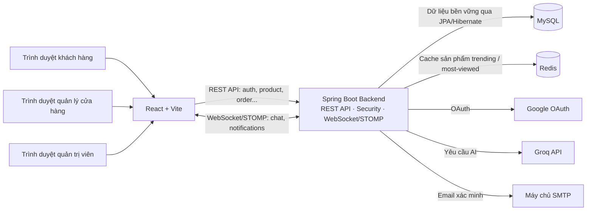
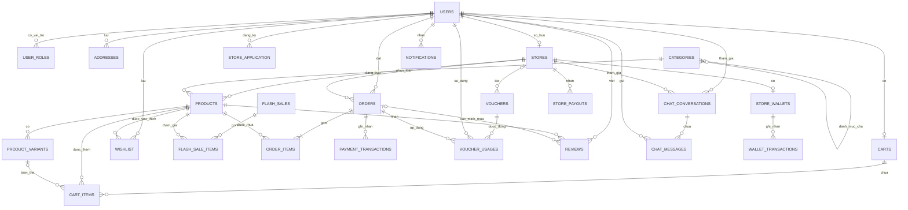

# NexCart — Nền tảng thương mại điện tử đa cửa hàng

## 1. Giới thiệu dự án

NexCart là dự án full-stack thương mại điện tử đa cửa hàng. Khách hàng có thể tìm và mua sản phẩm từ các cửa hàng; quản lý cửa hàng xử lý sản phẩm và đơn hàng của cửa hàng mình; quản trị viên quản lý người dùng, hồ sơ cửa hàng và hoạt động nền tảng.

Điểm nổi bật của dự án là mô hình **multi-vendor**: mỗi cửa hàng quản lý danh mục sản phẩm, voucher và đơn hàng của riêng mình, trong khi khách hàng có thể mua sắm và theo dõi đơn hàng trên cùng một nền tảng.

## 2. Demo
**Live Demo:** [ecommerce-system-gules.vercel.app](https://ecommerce-system-gules.vercel.app)
- Người xem có thể đăng ký tài khoản khách hàng trên website để thử luồng mua sắm. Muốn thử chức năng quản lý cửa hàng, cần có tài khoản cửa hàng đã được duyệt; quyền quản trị viên được cấp riêng và không công khai thông tin đăng nhập.
- Website demo có thể cần thời gian khởi động nếu dịch vụ backend đang ở chế độ ngủ. Google OAuth, gửi email và trợ lý AI cần backend được cấu hình Google OAuth, SMTP và Groq tương ứng.
- **Thanh toán:** hiện mô phỏng luồng thanh toán QR/chuyển khoản và xác nhận trong ứng dụng; chưa kết nối ngân hàng hoặc cổng thanh toán sandbox.

## 3. Tính năng

### Khách hàng

- Đăng ký, đăng nhập bằng mật khẩu hoặc Google OAuth; quản lý hồ sơ và địa chỉ giao hàng.
- Duyệt, tìm kiếm, lọc sản phẩm và cửa hàng; xem sản phẩm thịnh hành và được xem nhiều.
- Quản lý giỏ hàng và danh sách yêu thích.
- Đặt hàng, áp dụng voucher cửa hàng; backend tính giá giảm, thuế, phí giao hàng và tổng tiền.
- Theo dõi đơn hàng, hủy đơn trong trạng thái được phép và xác nhận đã nhận hàng.
- Đánh giá sản phẩm, nhận thông báo và chat với cửa hàng.

### Quản lý cửa hàng

- Gửi hồ sơ đăng ký mở cửa hàng; quản lý thông tin cửa hàng sau khi được duyệt.
- Quản lý sản phẩm, danh mục, biến thể, ảnh và chương trình giảm giá/flash sale.
- Xem và xử lý đơn thuộc cửa hàng; quản lý voucher và xem thống kê cửa hàng.
- Chat với khách hàng.

### Quản trị viên

- Quản lý người dùng, cửa hàng, hồ sơ đăng ký cửa hàng và đơn hàng.
- Xem thống kê nền tảng và phân khúc khách hàng RFM được tính ở backend. **Recency** là số ngày từ đơn gần nhất đã thanh toán và chưa hủy; **Frequency** đếm các đơn đã thanh toán và chưa hủy; **Monetary** cộng giá trị các đơn đã thanh toán và giao thành công. Hai nhóm chỉ số dùng điều kiện lọc khác nhau theo logic hiện tại. Backend quy đổi các chỉ số thành điểm theo quantile rồi xác định phân khúc khách hàng.

### Nghiệp vụ nền tảng

- Phân quyền theo vai trò khách hàng, quản lý cửa hàng và quản trị viên.
- Redis cache cho dữ liệu sản phẩm thịnh hành và được xem nhiều.
- Chat thời gian thực và thông báo qua WebSocket/STOMP.
- Trợ lý mua sắm gửi ngữ cảnh sản phẩm và hội thoại đến Groq qua backend để gợi ý/trả lời câu hỏi; tính năng cần `GROQ_API_KEY`. Backend cũng có thể gửi email xác minh qua SMTP khi được cấu hình.

## 4. Công nghệ sử dụng

| Phần | Công nghệ | Mục đích |
| --- | --- | --- |
| Frontend | React 19, Vite, React Router, TanStack Query, Zustand, Tailwind CSS, Axios | UI; routing; server state (TanStack Query); client state (Zustand); HTTP client (Axios) |
| Backend | Java 17, Spring Boot, Spring MVC, Spring Security, Spring Data JPA, Hibernate, MapStruct | REST API và nghiệp vụ; Hibernate ORM; MapStruct ánh xạ DTO/entity |
| Xác thực | JWT, Google OAuth 2.0, Spring Security, RBAC | Đăng nhập, xác thực request và phân quyền theo vai trò |
| Lưu trữ | MySQL 8, Redis 7 | Dữ liệu quan hệ và cache sản phẩm thịnh hành/được xem nhiều |
| Thời gian thực | WebSocket, STOMP, SockJS | Chat và thông báo trong ứng dụng qua endpoint WebSocket của backend |
| Tích hợp ngoài | Groq API, SMTP, Google OAuth | Trợ lý AI, email và đăng nhập Google; cần cấu hình thông tin tương ứng |
| Công cụ | Maven, npm, Docker, Docker Compose, Git, GitHub | Build, quản lý phụ thuộc, chạy local và quản lý mã nguồn |

## 5. Kiến trúc hệ thống



WebSocket/STOMP được cấu hình trực tiếp trong Spring Boot qua endpoint `/ws`, không phải một máy chủ riêng. Trong Docker Compose, frontend, backend, MySQL và Redis chạy trong cùng mạng Docker. Redis được dùng cho cache sản phẩm; sơ đồ không mô tả Redis là nơi lưu token. Google OAuth, Groq và SMTP là dịch vụ bên ngoài, cần thông tin cấu hình riêng.

## 6. ERD cơ sở dữ liệu

Sơ đồ dưới đây tóm tắt các thực thể quan hệ chính. Redis cache và dữ liệu token không thuộc ERD MySQL.



`USER_ROLES` là bảng liên kết vai trò của người dùng. Một số thực thể như giao dịch thanh toán, ví cửa hàng và payout có trong schema; nghiệp vụ thanh toán/chuyển tiền thực tế chưa được tích hợp đầy đủ. Backend hiện dùng Hibernate `ddl-auto=update`; với môi trường production nên quản lý thay đổi schema bằng migration đã kiểm duyệt.

Cardinality trong sơ đồ được đối chiếu với JPA entity hiện tại: `stores.user_id` là duy nhất nên mỗi user sở hữu tối đa một store; mỗi order có một store bắt buộc; một order có thể có nhiều payment transaction; mỗi store có tối đa một wallet; payout tham chiếu trực tiếp đến store. Tin nhắn tham chiếu một `User` làm sender (store manager cũng gửi bằng tài khoản user), không có sender loại system riêng trong entity. Đây là ERD theo mapping trong source, chưa phải bản reverse-engineer từ database production. `OrderService` hiện chỉ chấp nhận sản phẩm cùng một store trong một order; API không tự tách giỏ hàng nhiều store thành nhiều order.

## 7. Cấu trúc thư mục

```text
.
├── backend/
│   └── src/main/java/com/thanhhandsome/backend/
│       ├── configuration/  # Cấu hình Spring, security, JWT, WebSocket
│       ├── controller/     # REST controllers
│       ├── dto/            # Request và response DTO
│       ├── entity/         # Entity ánh xạ dữ liệu
│       ├── mapper/         # Chuyển đổi entity và DTO
│       ├── repository/     # Truy cập dữ liệu
│       └── service/        # Nghiệp vụ ứng dụng
├── frontend/
│   └── src/
│       ├── customer/       # Giao diện và luồng khách hàng
│       ├── storeManager/   # Giao diện quản lý cửa hàng
│       ├── admin/          # Giao diện quản trị
│       ├── components/     # Component dùng chung
│       ├── hooks/          # React hooks và truy vấn dữ liệu
│       ├── services/       # Gọi API
│       └── store/          # Client state (Zustand); khác với storeManager/
├── compose.yaml            # Frontend, backend, MySQL và Redis
└── .env.example            # Mẫu biến môi trường, không chứa secret thật
```

## 8. Cài đặt và chạy

### Yêu cầu

- Git và Docker Desktop có Docker Compose.
- Nếu chạy riêng frontend/backend: Node.js phù hợp với Vite và Java 17.

### Chạy toàn bộ bằng Docker

Tại thư mục gốc repository, tạo file `.env` từ mẫu:

```powershell
Copy-Item .env.example .env
```

Mở `.env` và thay các giá trị mẫu. Bảng dưới đây phân biệt biến bắt buộc để Compose khởi động và biến chỉ cần khi bật tính năng tương ứng:

| Biến | Mục đích | Bắt buộc |
| --- | --- | --- |
| `MYSQL_PASSWORD` | Mật khẩu user MySQL của ứng dụng | Có — Compose yêu cầu |
| `MYSQL_ROOT_PASSWORD` | Mật khẩu root MySQL | Có — Compose yêu cầu |
| `JWT_SECRET` | Khóa ký/xác minh JWT | Có — Compose yêu cầu |
| `MAIL_USERNAME` | Tài khoản SMTP | Có giá trị để Compose khởi động; cần tài khoản hợp lệ để gửi email |
| `MAIL_PASSWORD` | Mật khẩu/app password SMTP | Có giá trị để Compose khởi động; cần thông tin hợp lệ để gửi email |
| `ADMIN_EMAIL` | Email tài khoản admin cố định | Tùy chọn; đặt biến này sẽ bật khởi tạo admin |
| `ADMIN_PASSWORD` | Mật khẩu ban đầu cho admin mới | Cần khi `ADMIN_EMAIL` được đặt và tài khoản chưa có mật khẩu |
| `GOOGLE_CLIENT_ID`, `GOOGLE_CLIENT_SECRET` | Đăng nhập Google | Tùy chọn; cần cả hai để bật Google OAuth |
| `GROQ_API_KEY` | Trợ lý mua sắm AI | Tùy chọn; cần để gọi Groq |
| `REDIS_PASSWORD` | Mật khẩu Redis | Tùy chọn trong Compose hiện tại |
| `PUBLIC_URL`, `APP_HTTP_PORT` | URL public và cổng frontend local | Có giá trị mặc định trong `.env.example` |

Các biến OAuth redirect, S3/CloudFront và tên database/user MySQL cũng có mặc định trong `.env.example` hoặc `compose.yaml`. Không commit file `.env`.

=
Khởi động các dịch vụ:

```powershell
docker compose up --build -d
```

Kiểm tra trạng thái và log backend:

```powershell
docker compose ps
docker compose logs -f backend
```

Mở website tại [http://localhost:5173](http://localhost:5173). Dừng dịch vụ bằng:

```powershell
docker compose down
```

MySQL và Redis dùng named volume để giữ dữ liệu. Lệnh `docker compose down -v` sẽ xóa volume và dữ liệu local; chỉ dùng khi muốn tạo lại database từ đầu.

## 9. Tài khoản demo

- Repository không kèm sẵn tài khoản khách hàng hoặc quản lý cửa hàng dùng chung.
- Có thể đăng ký tài khoản khách hàng trực tiếp trên website.
- Tài khoản quản trị được khởi tạo theo `ADMIN_EMAIL` và `ADMIN_PASSWORD` trong `.env`; tự đặt thông tin local an toàn, không dùng mật khẩu thật trong README.
- Tài khoản quản lý cửa hàng được hình thành qua luồng đăng ký cửa hàng và phê duyệt.

## 10. Kiểm thử

Backend hiện có các lớp unit test dùng **JUnit 5 và Mockito** cho những service dưới đây. Các test mock repository/dependency nên không cần kết nối MySQL hoặc Redis. Chạy nhóm unit test trong PowerShell:

```powershell
cd backend
.\mvnw.cmd '-Dtest=AuthenticationServiceTest,ChatServiceTest,MostViewedCacheServiceTest,OrderServiceTest,ProductServiceTest,ReviewServiceTest,TrendingCacheServiceTest,UserServiceTest,VoucherServiceTest,WishlistServiceTest' test
```

| Nhóm | Phạm vi đang được kiểm thử |
| --- | --- |
| Authentication và User | Đăng ký/đăng nhập và xử lý người dùng |
| Order | Tạo đơn, tính tiền, tồn kho và trạng thái đơn |
| Product | Giá, phân trang và các trường hợp sản phẩm |
| Voucher | Hạn sử dụng và tính chiết khấu |
| Trending và Most Viewed | Đọc/ghi cache và truy vấn danh sách sản phẩm |
| Review và Wishlist | Quy tắc đánh giá và danh sách yêu thích |
| Chat | Quyền truy cập và xử lý hội thoại/tin nhắn |

Các test nằm trong `backend/src/test/java/com/thanhhandsome/backend/service/`. Chạy lệnh trên để xác nhận kết quả của checkout hiện tại; README không khẳng định toàn bộ test đã chạy thành công trong lần cập nhật này.

Chạy toàn bộ test backend bằng Maven Wrapper từ thư mục `backend`:

```powershell
cd backend
.\mvnw.cmd test
```

Lệnh này bao gồm `BackendApplicationTests`, một smoke test dùng `@SpringBootTest` để khởi tạo toàn bộ Spring context. Đây không phải bộ integration test nghiệp vụ đầy đủ; context dùng cấu hình ứng dụng và có thể kết nối dịch vụ đã khai báo, đồng thời chạy `AdminAccountInitializer` nếu `ADMIN_EMAIL` được cấu hình. Chỉ chạy với database/dịch vụ local hoặc test riêng, không dùng cấu hình production.

Phân biệt các loại kiểm thử trong repository:

- **Unit test chọn bằng `-Dtest=...`:** mock repository/dependency, tập trung vào logic từng service.
- **Spring context smoke test:** xác nhận ứng dụng dựng được context; không thay thế integration test cho từng luồng API.
- **Integration test nghiệp vụ:** hiện chưa có bộ riêng kiểm tra API với database test và các dịch vụ thật.

Frontend hiện chưa khai báo unit-test script. Có thể chạy kiểm tra lint và build:

```powershell
npm --prefix frontend run lint
npm --prefix frontend run build
```

Các kiểm thử tích hợp cần bổ sung gồm: voucher trong toàn bộ luồng đặt hàng, phân quyền endpoint, xác thực JWT hết hạn/thu hồi, cập nhật cache sau khi sửa dữ liệu và kiểm tra dữ liệu lưu trong DB bằng môi trường test riêng.

